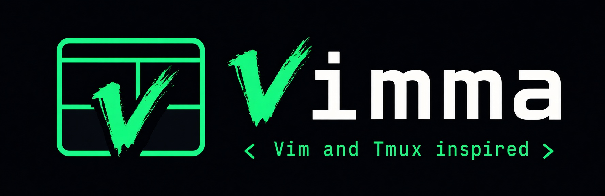

<p align="center">
  
</p>

# Vimma

**A keyboard-first browser for people who live in Vim and tmux.** You already have the muscle
memory; Vimma puts it to work on the web. Bare keys drive the page, `ctrl+b` drives tabs, panes
and workspaces, and your hands never leave the keyboard.

- **Vim on the page:** `j`/`k` to scroll, `f` for link hints, `/` to find, `:` for commands, and
  `Esc` to get back to normal mode.
- **tmux for the window:** `ctrl+b`, tmux's default prefix, then `c` for a new tab, `v` to split,
  `w` to switch workspace. If your fingers know tmux, they already know Vimma.
- **Every key is yours:** every binding, the prefix and the leader can be remapped in
  `config.toml`, Firefox's own keys too: `ctrl+t`, `alt+left` and `F12` are Vimma bindings
  with Firefox's meaning, listed in `ctrl+b ?`.

### The name

_Vimma_ is Finnish for a burst of eager, focused energy. You hear it in _työvimma_: a spell of
work where everything flows and the hours slip by. It also happens to start with _Vim_. That is
how browsing should feel: fast, fluent and absorbed.

### What it is

Vimma is for people who spend their day in Vim and a terminal multiplexer and want the browser to
work the same way. Pages get Vim's modes. Tabs and splits answer to tmux's `ctrl+b` prefix.
Each workspace is a container of its own, so the session you are signed in to at work stays out
of your personal one. The whole window can follow your desktop theme and change with it.

Underneath is Firefox (currently 158), a foundation you can trust: sites and add-ons work as they
do in Firefox, and Vimma starts with quieter defaults for your privacy.

## Features

**Vim on the page**

- Normal mode: `j`/`k`/`h`/`l` scroll, `d`/`u` or `ctrl+d`/`ctrl+u` half a page, `gg`/`G` top
  and bottom, `H`/`L` or `ctrl+o`/`ctrl+i` back and forward, `r` reload.
- Link hints: `f` labels every link, button and field on screen; type a label to follow it,
  `F` opens it in a background tab.
- Find: `/` searches as you type (smartcase, frames and PDFs too), `n`/`N` jump between matches.
- Copy mode: `v` puts a caret on the page; move it with Vim motions, select and `y` to copy.
- Insert mode: focusing a text field types as usual; `Esc` leaves it.
- Command line: `:open`, `:tabnew`, `:q`, `:map`, `:source` and any action by name, with
  completion and history.

**tmux-style tabs, panes and workspaces** (prefix `ctrl+b`)

- Tabs: `ctrl+b c` new, `ctrl+b n`/`p` next and previous, `ctrl+b 1..9` jump, `ctrl+b g` a
  fuzzy picker. Tabs can be renamed. Firefox's tab strip is hidden; the status bar shows where
  you are.
- Split panes: `ctrl+b v` and `ctrl+b -` split, `ctrl+b h/j/k/l` move, `ctrl+b z` zoom, plus
  swap, resize and close. Up to 4 panes, built on Firefox's own split view.
- Tiling layouts: `ctrl+b enter` opens a pane along the longer side (Hyprland's dwindle), and
  `ctrl+b space` cycles tmux's presets (even, main, tiled, a spiral) without reloading a page.
- Workspaces: each one is its own container, so logins and cookies stay apart. `ctrl+b )` /
  `ctrl+b (` switch, `ctrl+^` goes back to the last one as Vim's alternate buffer does,
  `ctrl+b w` picks one by name, and tabs move between them. Every workspace keeps its tabs and
  split layout across restarts.
- Private workspace: `ctrl+b shift+p` (or `ctrl+shift+p`) goes to Firefox's private window as
  if it were one more workspace, and back; closing it discards its data. On Hyprland it replaces
  the Vimma window in place.
- Side panel: `ctrl+b b` lists the workspace's tabs; pick one with `j`/`k`, or mark several
  with `space` / `V` and `Enter` shows them together as panes in the current layout. With a
  split, its panes start marked: unmark one to take it out, or down to one to end the split.
- Going to a tab outside a split shows it alone and keeps the split, hidden, until you go to one
  of its tabs again (`split 3 hidden` in the status bar); a new tab still opens in the focused
  pane.
- `ctrl+b ?` lists every binding, searchable.
- `ctrl+b u` hides the toolbar; it comes back when you need the address bar
  ([guide](docs/guide.md#hiding-the-toolbar)).

**Yours to configure**

- Every key is yours: any binding, the `ctrl+b` prefix and the `space` leader can be remapped in
  `~/.config/vimma/config.toml`, e.g. `keys.prefix = "ctrl+a"`
  ([guide](docs/guide.md#every-key-is-yours)). Firefox's own shortcuts (`ctrl+t`, `ctrl+l`,
  `alt+1..9`, `ctrl+plus`, the DevTools keys) are Vimma bindings too, with Firefox's meaning,
  and `ctrl+b ?` lists them with the rest.
- `~/.config/vimma/config.toml` sets options, key bindings and workspaces, and applies on save.
  `about:vimma` shows the version and what is in force.
- Theming: the bars, pickers, hints, start page and Firefox's own sidebar take their colours
  from your desktop theme and switch at once when it changes, or from your own colours in
  `config.toml` (by default Vimma's own vimma.dev palette, light or dark as your system is, or
  as you pick with `:theme`; Tokyo Night by name).
- Accessible: Vimma's own UI works with a screen reader, keeps focus where you left it, and its
  text meets WCAG AA contrast in dark and light themes
  ([guide](docs/guide.md#accessibility)).

**Firefox underneath, with quieter defaults**

- Same user agent and add-on compatibility as Firefox, so sites and extensions work as you
  expect.
- No studies, experiments, sponsored content or telemetry uploads. Safe Browsing stays on.
- Scriptable: an optional, token-protected control socket and the `vimma-ctl` CLI.
- Local AI agents (Claude Code, Codex, opencode, Copilot) through MCP: `vimma-ctl mcp` lets them
  list, read, open and close tabs of one `agent` workspace, with its own logins, and every
  request asks you first ([guide](docs/guide.md#connecting-an-agents-tool)).

The [user guide](docs/guide.md) covers every key and option,
[docs/limits.md](docs/limits.md) lists what does not work yet, and
[docs/security.md](docs/security.md) is the security model (report issues as
[SECURITY.md](SECURITY.md) says).

## Status

**Pre-alpha.** Everything above works today, and Vimma is being used as a daily browser ahead of
its first release. There are no packages or binaries yet: you build it from source, on Linux
x86_64 only. Version `0.1.0`, on Firefox 158.0.

### How it is built

Vimma is built with heavy AI assistance (Claude Code): features start as written specs, are
built test-first by AI agents, reviewed, and checked by CI and the security model in
[docs/security.md](docs/security.md). The author reviews the work and tries it in daily use before each release.
[CLAUDE.md](CLAUDE.md) holds the rules the agents follow.

## Getting started

The first build takes under an hour and about 35 GB of disk:

```sh
npm ci && npx surfer download && npx surfer bootstrap
npm run import && npx surfer build
npm start
```

Google Safe Browsing (phishing and malware protection) needs an API key, which is not in this
repository. A build without one works but shows the protection as off. To turn it on, get a free
key from Google and save it as `~/.config/vimma/keys/safebrowsing` before building
([docs/runbook.md](docs/runbook.md#google-safe-browsing-key-spec-m0-safebrowsing-key)). Release
packages are built with a key.

`npm start` opens Vimma with a profile of its own, so your Firefox profile is never touched.
Press `ctrl+b ?` to see every binding. [CONTRIBUTING.md](CONTRIBUTING.md) has the rest:
requirements, faster front-end-only rebuilds, tests, the project layout and how changes are made.

## Licence

[MPL-2.0](LICENSE), like Firefox. The vendored TOML parser
[smol-toml](https://github.com/squirrelchat/smol-toml) (`packages/vimma-core/src/vendor/smol-toml/`)
is BSD-3-Clause ([ADR-012](docs/adr/012-toml-parser-smol-toml.md)); its notice is in the browser's
`about:license`, with Firefox's own third-party licences.

## Acknowledgements

- [Vim](https://www.vim.org/) and [tmux](https://github.com/tmux/tmux), the two programs Vimma is
  modelled on: Vim for the modes, tmux for the `ctrl+b` prefix, panes, layouts and sessions.
- [Firefox](https://www.mozilla.org/firefox/) and Mozilla, for the browser underneath.
- [Surfer](https://github.com/zen-browser/surfer) and [Zen Browser](https://zen-browser.app/),
  for the build toolchain and for showing how to run a Firefox fork this way.
- [Herdr](https://herdr.dev/), whose `[keys]` syntax (`action = [chords]`) and action names
  `config.toml` follows.
- [Omarchy](https://omarchy.org/), whose themes Vimma follows.
- [Tridactyl](https://github.com/tridactyl/tridactyl) and [Vimium](https://github.com/philc/vimium), prior art for Vim keys in a browser.
