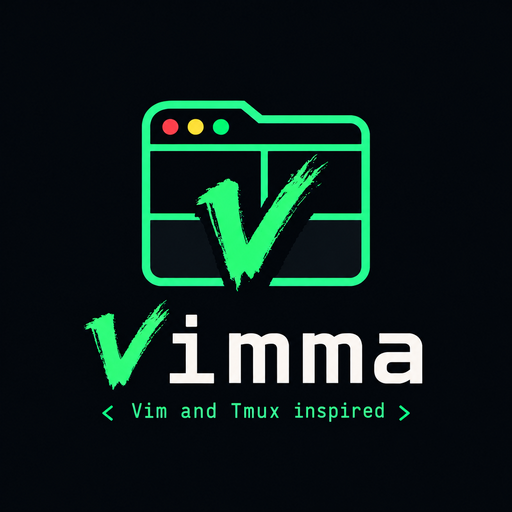

<p align="center">
  
</p>

# Vimma

**A keyboard-first browser, inspired by Vim and Tmux.** Browse the way you edit text and juggle
terminal sessions: modal keys for the page, a `ctrl+b` prefix for tabs, panes and workspaces, and
your hands never leave the keyboard.

- **Vim** brings the modal layer: `j`/`k` to scroll, `f` for link hints, `/` to find, `:` for
  commands, and `Esc` to get back to normal mode.
- **Tmux** brings the prefix layer: `ctrl+b c` for a new tab, `ctrl+b v` to split, `ctrl+b w` to
  switch workspace, the same muscle memory as in your terminal (via
  [Herdr](https://herdr.dev/)'s keymap).

### The name

_Vimma_ is a Finnish word for a burst of eager, focused energy: the state of being on a roll. You
hear it in _työvimma_, a spell of working when everything flows. It also happens to start with
_Vim_. That is how browsing should feel: fast, fluent and absorbed.

### What it is

Vimma is a Firefox fork. The plan: Neovim-style modal control of the page, Herdr's prefix keymap
(`ctrl+b`) for tabs, panes and workspaces, `ctrl+b ?` to show every binding, workspaces as
isolated Firefox containers, an on-demand side panel, an always-visible status bar, and an
[Omarchy](https://omarchy.org/)-native look. It is built with
[Surfer](https://github.com/zen-browser/surfer), the toolchain behind Zen Browser, on the Firefox
release channel.

## Status

**Pre-alpha, not yet daily-driven.** M0 (fork, pipeline, control socket, e2e), M2 (tabs,
status bar, picker), M3 (workspaces), M4 (split panes) and M5 (`config.toml`, Omarchy theme)
are done; M1's modal page layer is done except back, forward and reload (`H`/`L`/`r`, in
review). M6 (packaging, updates) has its tooling but waits on release accounts.
There are no binaries yet: you build from source. Version `0.1.0`, on Firefox 157.0.1.

What works today:

- **Branding.** The browser calls itself Vimma (`vimma --version`, the window title, About); the
  start page shows the Vimma logo, while the app icon is still a placeholder. Its profiles are separate from Firefox's.
- **Vim keys on pages.** In normal mode `j`/`k` scroll, `d`/`u` scroll half a page and `gg`/`G`
  go to the top and bottom. Focusing a text field enters insert mode, so typing works as usual;
  `Esc` leaves it and `i` enters it.
- **Link hints.** `f` labels every link, button and field on screen, also inside frames from
  other sites; typing a label follows or focuses it. `F` opens a link in a background tab.
- **Find.** `/` searches the page as you type (frames and PDFs too), with Vim's smartcase;
  `Enter` keeps the match, `Esc` goes back, `n`/`N` jump between matches and `?` searches
  backward. The status bar shows `/word [2/5]` or `not found`.
- **Copy mode.** `v` or `ctrl+b [` puts a caret on the page (`VISUAL`); `h j k l w b 0 $ gg G`
  move it, `v` starts a selection, `y` copies it as plain text and `Esc` leaves.
- **`ctrl+b ?`** opens an overlay listing every binding, over any page, including
  `about:preferences` and the PDF viewer. `/` filters the list and `Esc` or `q` closes it.
  Bindings that do not run yet are dimmed.
- **Herdr tab keys.** `ctrl+b c` new tab, `ctrl+b n`/`p` next/previous (wrapping),
  `ctrl+b 1..9` tab N, `ctrl+b shift+x` close tab, from any page and the URL bar; in normal
  mode also `t`, `x`, `gt`/`gT`.
- **`:` command line.** At the bottom of the window: `:tabnew`, `:q`, `:open example.com`
  (or search words), `:map`, and any action by name, with `Tab` completion, `Up`/`Down`
  history and inline errors that suggest the command you meant.
- **Start page.** New windows and new tabs open a Vimma page with the logo and the keys to
  start from; the URL bar stays empty and focused.
- **Status bar.** A one-line status bar at the foot of the window shows the mode, pending keys
  (`prefix` after `ctrl+b`), `tab 2/5`, the page title (or your rename), its URL and whether it
  is loading.
- **Goto picker and tab rename.** `ctrl+b g` (or `:ls`) lists the window's tabs: `j`/`k` to
  move, `/` to search titles, URLs and renames (`kä` finds "Käyttäjät" first, `ka` still finds
  it), `Enter` to go. `ctrl+b shift+t` or `:tabrename name` names a tab; the name shows in the
  status bar and the picker and survives a restart.
  `ctrl+b ?` is the one place that lists the bindings.
- **Split panes.** `ctrl+b v` / `ctrl+b -` (or `:vsplit` / `:split`) split right and down,
  `ctrl+b h/j/k/l` (or `ctrl+w h/j/k/l`) or a click move between panes, `ctrl+b z` zooms,
  swap and resize mode rearrange them and `ctrl+b x` or `:q` closes a pane; up to 4 panes,
  shown as `pane n/m` in the status bar. Splits made with Firefox's own split view become panes.
- **Workspaces.** Each workspace is its own container, with separate cookies and logins.
  `ctrl+i` / `ctrl+u` switch, `ctrl+b w` picks one by name (with tab counts), and
  `ctrl+b shift+n/w/d` (or `:wsnew`, `:wsrename`, `:wsdelete`) create, rename and delete
  them; delete asks first. `:wsmove` or `m` in the picker moves a tab to another workspace.
  Each workspace keeps its tabs and its split, across switches and restarts.
- **Side panel.** `<leader>n`, `ctrl+b b` or `:sidebar` toggles a panel listing the current
  workspace's tabs; `j`/`k`, `Enter` or `1..9` pick one.
- **`config.toml`.** `$XDG_CONFIG_HOME/vimma/config.toml` sets options, key bindings and
  workspaces, and is re-read within 2 seconds of a save; `:source` reads it at once,
  `:source <path>` loads another file and `:config` opens it. Errors show in the status bar,
  and `about:vimma` shows the version, patches and state.
- **Omarchy theme.** The status bar, pickers, command line, hints and start page take their
  colours from your current Omarchy theme and follow `omarchy-theme-set` within 2 seconds, or
  at once with the optional theme-set hook; without Omarchy, Tokyo Night.
- **Hidden tab strip.** Firefox's tab strip is hidden. Firefox's own tab keys (`ctrl+t`,
  `ctrl+w`, `ctrl+tab`, `alt+1..9`, …) still work. Set `vimma.ui.tabstrip.hidden` to `false` in
  `about:config` to bring the strip back.
- **Privacy defaults.** Mozilla studies, experiments and rollouts (Normandy, Nimbus) are off, and
  so are sponsored new-tab content, sponsored suggestions and Mozilla promos. The build has no
  crash reporter and no official telemetry, so nothing is uploaded. Remote Settings, CRLite,
  the add-on blocklist, Sync and AMO work as in Firefox. Google Safe Browsing is on in builds
  made with a Google API key; a build without one shows it off in Settings. Each default can be
  turned back on, or off, in `about:config`.
- **Control socket and `vimma-ctl`** (off by default). With `vimma.control.enabled` on,
  `vimma-ctl state`, `send-keys "ctrl+b ?"` and `open <url>` drive a running Vimma from a shell or
  a test, over a token-protected socket on `127.0.0.1`. Build the client with
  `cargo build --release` in `tools/vimma-ctl/`. See [docs/guide.md](docs/guide.md#scripting-with-vimma-ctl).
- **Firefox-compatible.** Sites see Firefox 157's user agent, byte for byte. Add-ons, webcompat
  fixes and Remote Settings see Firefox's version number.

What does not work yet: every default binding runs, including back, forward and reload
(`H`/`L`/`r`), but there are no packages or updates yet. See
[docs/guide.md](docs/guide.md) and [docs/limits.md](docs/limits.md).

## Requirements

- Linux x86_64 (the only platform built and tested so far).
- About 35 GB of free disk space, as measured on the dev box: `engine/` 27 GB (source and the
  full build), the sccache compiler cache 6.8 GB, toolchains in `~/.mozbuild` 3.1 GB and the
  Firefox source download in `.surfer/` 0.8 GB.
- Node.js 20 or later, Python 3, git.
- Time: the first full build took 39 min on a 16-thread Ryzen with 58 GB RAM. The Firefox source
  download took 12.5 min. See [docs/runbook.md](docs/runbook.md).

## Build and run

```sh
npm ci                  # dev tools, including Surfer
npx surfer download     # Firefox source for the version in surfer.json, into engine/
npx surfer bootstrap    # Mozilla's toolchains into ~/.mozbuild (once)
npm run import          # apply Vimma's files and patches, select the vimma brand
npx surfer build        # full build
```

Run it:

```sh
npm start               # full build if present, else the artifact build; ~/.cache/vimma-dev-profile
npm start -- --fresh    # a throwaway profile instead
npm start -- --import   # run `npm run import` first
npm start -- --profile DIR -- --jsconsole   # another profile; after the second -- browser flags
```

`npm start` (`tools/start.mjs`) passes its own profile, so it never touches your Firefox profile
(remoting is keyed by app name and profile: a `vimma` command line never reaches Firefox), and refuses to start a second instance on the same profile. It adds
one line to the profile's `user.js` (other lines are kept):
`security.sandbox.content.read_path_whitelist` set to this checkout's `src/`. A local build's
front-end files are symlinks into `src/`, outside the Firefox tree, and without that pref the
content sandbox refuses them, so Vimma's page actor never loads (packaged builds copy the files
and do not need it). `npx surfer run` uses a scratch profile without it.

After editing JavaScript or CSS under `src/`, run `npm run import && npx surfer build --ui`. That
rebuilds only the front end. Changes to branding, `configs/` or `moz.configure` need a full
`npx surfer build`.

## Testing

```sh
npm test                 # Vitest: vimma-core and tools (fast, no browser)
npm run typecheck        # tsc --checkJs
npm run lint             # eslint + prettier --check
npm run mochitest -- tests/browser/                       # browser tests on your full build
npm run mochitest -- tests/browser/browser_vimma_tabstrip.js
```

You can also test the front end without a full build. An artifact build puts our front end on
top of Mozilla's compiled binaries for the same release, and is what PR CI uses
([ADR-010](docs/adr/010-pr-artifact-builds.md)):

```sh
npm run import
node tools/artifact-build/artifact-build.mjs    # ~25 s warm; first run downloads 163 MB
npm run mochitest -- --artifact tests/browser/
```

An artifact build cannot check compiled-in settings (the `--version` string, the crash reporter
flag). A PR that touches patches, `configs/`, `moz.configure` or branding must report a
mochitest run on a full build.

## Project layout

| Path                              | What                                                                                                                          |
| --------------------------------- | ----------------------------------------------------------------------------------------------------------------------------- |
| `packages/vimma-core/`            | Pure ES modules with no Firefox imports: key notation, actions, keymap, dispatcher, config and theme. Tested with Vitest.     |
| `src/browser/base/content/vimma/` | Our browser code: the key host, UI (help overlay, tab strip) and services. `core/` is copied in by `npm run sync-core`.       |
| `src/**/*.patch`                  | The small upstream patches, each listed in [ADR-003](docs/adr/003-own-files-minimal-patches.md).                              |
| `configs/`                        | mozconfigs and branding inputs.                                                                                               |
| `tests/browser/`                  | Mochitests (`browser_vimma_*.js`).                                                                                            |
| `tools/`                          | Build, upstream-bump, licence and commitlint helpers.                                                                         |
| `docs/`                           | [User guide](docs/guide.md), [bindings](docs/bindings.md), [limits](docs/limits.md), specs, ADRs, [runbook](docs/runbook.md). |

## Contributing

Vimma follows a spec-first, test-first loop ([plan.md](plan.md) §4–§5):

- **Specs.** Every feature starts as `docs/specs/<milestone>-<feature>.md`, with acceptance
  criteria written as Given/When/Then. Boundary changes and new upstream patches need an ADR in
  `docs/adr/`.
- **TDD.** Write the failing test and run it, then implement until it passes. Never loosen a test.
- **Commits.** Use Conventional Commits with a body: the subject is the changelog line; the body
  explains why.
  `npx commitlint --from origin/main` checks this, and CI rejects `feat` and `fix` commits
  without a body.
- **Docs.** A user-visible change updates [docs/guide.md](docs/guide.md), and this README's
  status if it changes what works. See [docs/review-checklist.md](docs/review-checklist.md).
- **Agents.** [CLAUDE.md](CLAUDE.md) sets the rules for AI coding agents. They apply to human
  contributors too.

Before pushing, run `npm test`, `npm run typecheck`, `npm run lint`, `npm run test:py`,
`npm run license-check` and `npx surfer license-check`.

## Licence

[MPL-2.0](LICENSE), like Firefox. The vendored TOML parser
[smol-toml](https://github.com/squirrelchat/smol-toml) (`packages/vimma-core/src/vendor/smol-toml/`)
is BSD-3-Clause ([ADR-012](docs/adr/012-toml-parser-smol-toml.md)).

## Acknowledgements

- [Firefox](https://www.mozilla.org/firefox/) and Mozilla, for the browser underneath.
- [Surfer](https://github.com/zen-browser/surfer) and [Zen Browser](https://zen-browser.app/),
  for the build toolchain and for showing how to run a Firefox fork this way.
- [Herdr](https://herdr.dev/), whose keymap is the prefix layer.
- [Omarchy](https://omarchy.org/), whose themes Vimma will follow.
- [Tridactyl](https://github.com/tridactyl/tridactyl), the planned reference for link hints.
